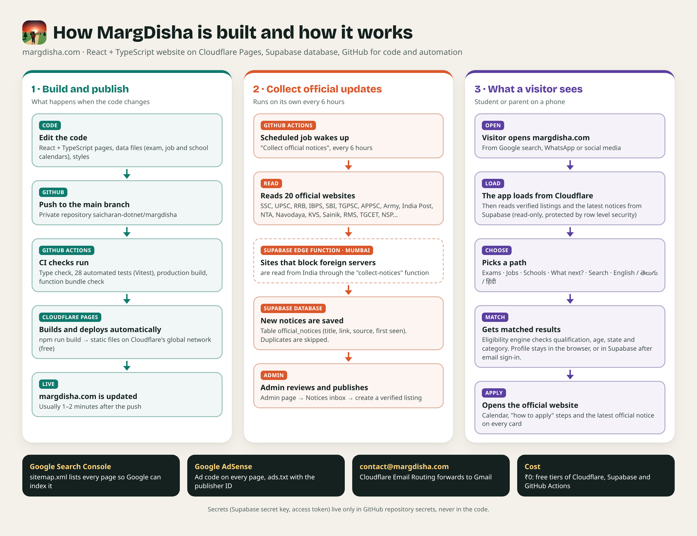
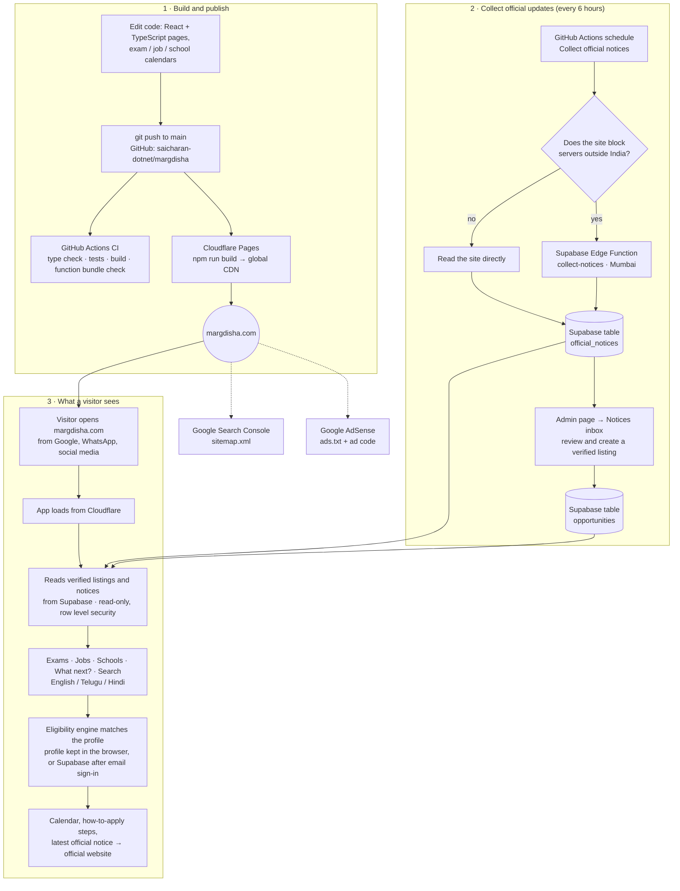

# How MargDisha is built and how it works

MargDisha (margdisha.com) helps students and parents in India find their next step: entrance exams,
government jobs, school admissions, scholarships and courses. It is a React + TypeScript website
hosted on Cloudflare Pages, with a Supabase (PostgreSQL) database, and GitHub for code and automation.
Running cost: ₹0 on the free tiers.

## Flowchart

## Where things live

| Part | Where | Notes |
|---|---|---|
| Pages | `src/pages/` | Home, Exams, Jobs, Schools, Explore (What next?), Matches, Search, Updates, Admin, About, Privacy, Terms |
| Exam guide | `src/data/exam-guide.ts` | POLYCET, RGUKT IIIT, JEE, JoSAA, EAPCET, NEET, CUET, ECET, GATE, ICET and more |
| Job calendar | `src/data/job-calendar.ts` | UPSC, SSC, Railways, banks, postal, defence, TG/AP Groups, police, teachers, power, steel, BHEL and PSUs, DRDO, ISRO, CSIR, BARC, doctors and nurses, TTD, courts, RTC |
| Private jobs | `src/data/private-jobs.ts` | Ways in by qualification and sector, with how to apply |
| School calendar | `src/data/school-calendar.ts` | KV Class 1, Gurukul Class 5, Navodaya, Sainik, RMS, EMRS, NMMS |
| Eligibility engine | `src/engine/match.ts` | Pure functions, unit tested |
| Languages | `src/i18n/strings.ts` | English, Telugu, Hindi |
| Notice collector | `src/notices/`, `scripts/collect-notices.ts`, `.github/workflows/notices.yml` | See `docs/NOTICES.md` |
| Edge function | `supabase/functions/collect-notices/` | Built from `src/notices` with `npm run fn:build` |
| Database | `supabase/migrations/` | See `docs/DATABASE.md` |
| SEO and ads | `public/sitemap.xml`, `public/robots.txt`, `public/ads.txt`, `index.html` | |

Secrets (Supabase secret key, Supabase access token) are stored only as GitHub repository secrets,
never in the code. The Supabase publishable key in the code is public by design; row level security
decides what each visitor can read or write.

## Technologies used, and where to learn them

| Technology | What it does in MargDisha | Learn it |
|---|---|---|
| SQL and PostgreSQL | The database behind Supabase: tables, queries, row level security | [dotnetbrief.com](https://dotnetbrief.com) · [PostgreSQL tutorial](https://www.postgresql.org/docs/current/tutorial.html) |
| .NET (C#) | Not used in this site, but the natural next step for a .NET backend or admin tools | [dotnetbrief.com](https://dotnetbrief.com) |
| HTML and CSS | Page structure and the visual theme | [MDN Learn web development](https://developer.mozilla.org/en-US/docs/Learn_web_development) |
| JavaScript | The language of the web | [javascript.info](https://javascript.info) |
| TypeScript | JavaScript with types; all of the app's code | [TypeScript Handbook](https://www.typescriptlang.org/docs/handbook/intro.html) |
| React | The user interface (pages and components) | [react.dev/learn](https://react.dev/learn) |
| Vite | Development server and production build | [Vite guide](https://vite.dev/guide/) |
| Vitest | Automated tests | [Vitest guide](https://vitest.dev/guide/) |
| Playwright | Browser automation for screenshots and the demo video | [Playwright docs](https://playwright.dev/docs/intro) |
| Supabase | Database, sign-in by email link, Edge Functions | [Supabase docs](https://supabase.com/docs) · [Row level security](https://supabase.com/docs/guides/database/postgres/row-level-security) · [Edge Functions](https://supabase.com/docs/guides/functions) |
| Git and GitHub | Code history and collaboration | [GitHub Skills](https://skills.github.com) · [Pro Git book](https://git-scm.com/book/en/v2) |
| GitHub Actions | CI checks and the 6-hourly notice collector | [GitHub Actions docs](https://docs.github.com/en/actions) |
| Cloudflare Pages | Hosting and automatic deploys | [Cloudflare Pages docs](https://developers.cloudflare.com/pages/) |
| Cloudflare Email Routing | contact@margdisha.com → Gmail | [Email Routing docs](https://developers.cloudflare.com/email-routing/) |
| Google Search Console | Getting pages into Google search | [Search Console help](https://support.google.com/webmasters) |
| Google AdSense | Ads on the site | [AdSense help](https://support.google.com/adsense) |
